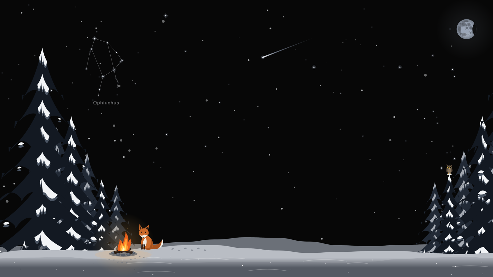
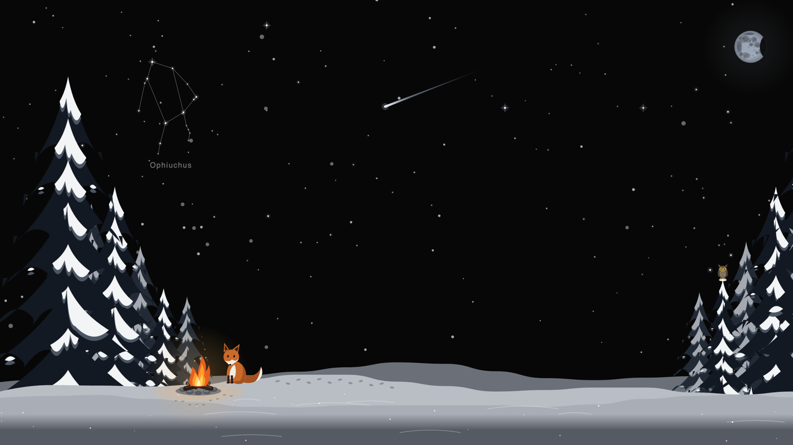
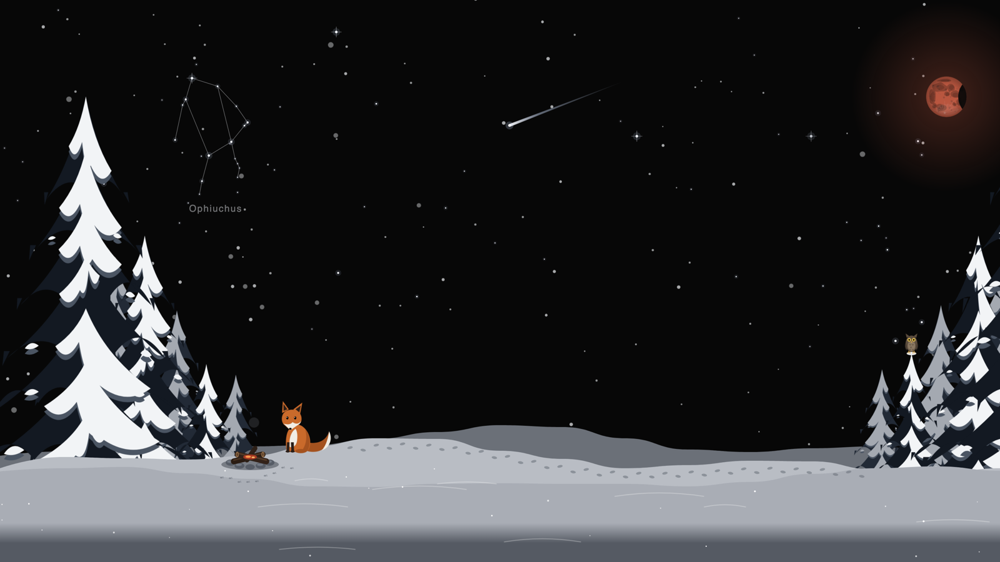

# Forest Winter: an animated Claude Code theme and wallpaper

**Claude Forest Winter** is a free, open-source **Claude Code theme**: an animated winter forest **wallpaper** (background) behind your chats in the Claude desktop app (Code tab) and the Claude mobile app. Snowy pines, falling snow that piles up as your context fills, a campfire that burns while Claude works, a fox and a moon in its real phase. It is one light vector drawing, so it needs no GPU.


## What it does

- **Snow shows your context.** The ground rises and the pines turn white as the conversation's context fills. The status line says `❄ snow 34%`.
- **The moon warns you.** It is drawn in tonight's real phase, sinks and turns amber at 60% context, then red at 85%.
- **The campfire shows work.** It catches when you send a message, burns while Claude, a background agent or a background command is working, and dies down to embers once the answer is done.
- **Footprints.** One more step across the snow for each message you send.
- **A fox** trots in when you open a chat and sits by the fire. A couple of minutes after the fire goes out it trots off into the dark, and it comes back when the fire is lit again. **An owl**, on rare nights, glides in and lands on the tip of a pine.
- **All 88 constellations**, two at a time, with real star positions and magnitudes. A new pair every quarter of an hour. The lines draw themselves now and then, with the name in small print; click the sky to name the one on that side.
- **Rare shooting stars**, wind that slants the snow, snow sliding off a branch.
- A near-black theme with light text, and no blur or veil over the conversation.

| Light snow | Half full | Nearly full |
| --- | --- | --- |
|  |  |  |

The pictures show the backdrop alone; your chat sits on top of it.

## Install

At the prompt of a Claude Code terminal session:

```
/plugin install forest-winter --marketplace sileeex/claude-forest-winter
```

Answer `y` to add the marketplace, then pick a scope (user scope applies it to every chat). From a shell:

```
claude plugin install forest-winter --marketplace sileeex/claude-forest-winter
```

In the desktop app: click **+** next to the prompt box, then **Plugins**, **Add marketplace** with `sileeex/claude-forest-winter`, then **Add plugin**.

The backdrop is drawn in the desktop and mobile apps, not in the terminal.

## Option

`effects`:

- `drawing` (default): everything is a vector drawing. Very light.
- `shader`: adds a thin green aurora on some nights and snow lying on the message box, computed on the GPU. It uses more power and can make the picture a little softer.

## Notes

- With "reduce motion" on, the snow does not fall but still piles up.
- `assets/forest-winter.svg` is the backdrop as a standalone animated SVG.

## Fond d'écran animé pour Claude (en français)

**Forest Winter** est un thème et un fond d'écran animé gratuit pour Claude Code et l'app Claude sur ordinateur : une forêt de sapins enneigés la nuit, de la neige qui monte avec le contexte de la conversation, un feu de camp qui brûle pendant que Claude travaille, un renard, une lune dans sa vraie phase et les 88 constellations. Installation : voir la section Install plus haut.

## License

MIT, see [LICENSE](LICENSE). Constellation and star data derived from d3-celestial (BSD 3-Clause), see [NOTICE.md](NOTICE.md).
