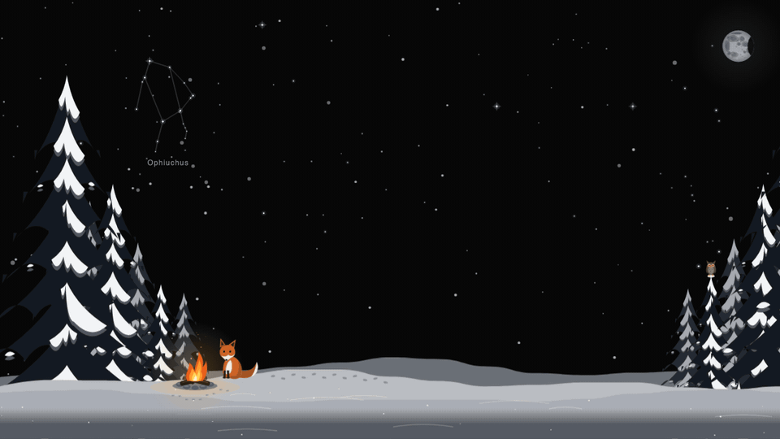

# Forest Winter — a Claude Code mod

A winter night behind your Claude chats: an animated theme and backdrop mod for the Claude desktop app (Code tab) and mobile app. One light vector drawing, no GPU needed.



## What it does

- **Snow shows your context.** The ground rises and the pines turn white as the conversation's context fills. The status line says `❄ snow 34%`.
- **The moon warns you.** It is drawn in tonight's real phase, sinks and turns amber at 60% context, then red at 85%.
- **The campfire shows work.** It catches when you send a message, burns while Claude or a background agent is working, and dies down to embers once the answer is done.
- **Footprints.** One more step across the snow for each message you send.
- **A fox** sits by the fire most of the time, moves off, leaves tracks and comes back. **An owl** shows up rarely, on the tip of a pine.
- **All 88 constellations**, two at a time, with real star positions and magnitudes. The lines and the name fade in now and then, and under the pointer.
- **Rare shooting stars**, wind that slants the snow, snow sliding off a branch.
- A near-black theme with light text, and no blur or veil over the conversation.

| Light snow | Half full | Nearly full |
| --- | --- | --- |
|  |  |  |

The pictures show the backdrop alone; your chat sits on top of it.

## Install

At the prompt of a Claude Code terminal session:

```
/plugin install forest-winter --marketplace sileeex/claude-forest-winter
```

Answer `y` to add the marketplace, then pick a scope (user scope applies it to every chat). From a shell:

```
claude plugin install forest-winter --marketplace sileeex/claude-forest-winter
```

In the desktop app: click **+** next to the prompt box, then **Plugins**, **Add marketplace** with `sileeex/claude-forest-winter`, then **Add plugin**.

The backdrop is drawn in the desktop and mobile apps, not in the terminal.

## Option

`effects`:

- `drawing` (default): everything is a vector drawing. Very light.
- `shader`: adds a thin green aurora on some nights and snow lying on the message box, computed on the GPU. It uses more power and can make the picture a little softer.

## Notes

- With "reduce motion" on, the snow does not fall but still piles up.
- `assets/forest-winter.svg` is the backdrop as a standalone animated SVG.

## License

MIT, see [LICENSE](LICENSE). Constellation and star data derived from d3-celestial (BSD 3-Clause), see [NOTICE.md](NOTICE.md).
